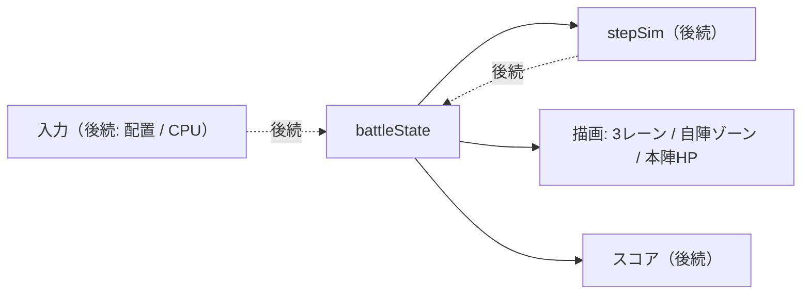

# 設計: ユニット1「フィールド整備」

（親：`requirements.md` 要件 1・2・6・8 ／ ロードマップ：`plan.md`）

## 概要

3 レーンの盤面・自陣の配置ゾーン・本陣を用意し、以降のユニットが乗る土台を作る。この段では**ユニットはまだ動かない（＝箱だけ）**。ここで「対戦 state と描画の分離」の骨格も最小限だけ入れておく（state は本陣 HP を持ち、描画はそれを読むだけ）。

## このユニットのスコープ

やること：
- 仮想座標系とレーン／配置ゾーン／本陣のジオメトリを config 化する。
- 対戦 state の土台（`createBattleState`）を作る（この段では `units` は空、`base.hp` を持つ）。
- 盤面の描画：3 レーン、自陣の配置ゾーン（3 レーン×前後 3 段＝9 セル、**自分側のみ**）、本陣 HP バー（両陣営）。
- state → 描画の一方向反映の骨格（本陣 HP を変えるとバーが動く）。

やらないこと（後続ユニット）：
- ユニットの出撃・移動・交戦（ユニット 2）
- タップによる配置操作（ユニット 3）
- CPU・スコア・難易度（4／5／6）
- seed 付き RNG・エナジー（乱数/出撃が要るユニット 2・3 で導入）

## データモデル

### config への追加（`data/lanebattle_config.json`、キー案）

```
field: {
  virtualWidth, virtualHeight,
  laneCount: 3,
  laneYs: [ ... ],       // 各レーンの中心 y（仮想座標）
  laneHeight,
  midX,                  // 中央ライン（自陣／敵陣の境）
  youBaseX, cpuBaseX     // 本陣の x
}
deploy: {
  steps: 3,              // 自陣内の前後段数（後方 / 中 / 前方）
  youSlotXs: [ ... ],    // 自分側 3 段の x（すべて midX より自陣側）
  cpuSlotXs: [ ... ]     // 敵側 3 段の x（CPU 用。midX より敵陣側）
}
base: {
  hp,                    // 本陣（守り神）の体力。両陣営 1 つずつ
  defense: { atk, range, intervalMs }  // 最終防衛（任意）。既存 guardian を本陣に統合
}
timeLimitMs              // 制限時間（スコア・タイムアップ判定はユニット 5 で使用）
```

> 既存の `guardian`／`youBaseX`／`cpuBaseX` は、この `field`／`base` に読み替えて集約する（本陣は要件 6 のとおり各陣営 1 つ）。

### 対戦 state の土台（新規 `engine/battleState.js`、案）

```
createBattleState(config) → {
  base: { you: { hp: config.base.hp }, cpu: { hp: config.base.hp } },
  units: [],            // 後続ユニットで使用
}
```

純オブジェクト（DOM/React 非依存）。以降のユニットで `t`／`energy`／`rng` などを足していく。

## インターフェース（このユニットで作る/触るもの）

| 対象 | 種別 | 責務 |
|---|---|---|
| `data/lanebattle_config.json` | 変更 | `field`／`deploy`／`base`／`timeLimitMs` を追加 |
| `engine/battleState.js` | 新規 | `createBattleState(config)`：本陣 HP を持つ state 土台を返す |
| `BattleView.jsx` | 変更 | 3 レーン・自陣ゾーン・両本陣 HP バーを描画。`state.base` を props で受けて HP を反映 |
| `lanebattle.css` | 変更 | レーン帯・自陣ゾーンの薄い塗り・本陣 HP バーのスタイル |

## 描画方針

- 盤面の「器」は React（`BattleView.jsx`）＋ CSS で組む：3 レーンの要素、自分側の配置ゾーンの薄い塗り（9 セル）、両陣営の本陣 HP バー。
- ユニットは後続で各レーン要素の中にエンジンが描く（既存 `laneSprite` をレーン対応に拡張予定）。この段ではレーンの「入れ物」まで。
- 座標は仮想座標（`virtualWidth`/`virtualHeight`）→ % 変換で既存方式を踏襲。

## データフロー（この段の骨格）



## タスク（ユニット1）

- [x] **1. config にフィールド定義を追加**
  - 内容：`field`／`deploy`／`base`／`timeLimitMs` を追加（数値は仮でよい）
  - ファイル：`data/lanebattle_config.json`
  - 完了条件：JSON が妥当で、上記キーがそろう
- [x] **2. 対戦 state の土台を作る**
  - 内容：`createBattleState(config)` が本陣 HP を持つ state を返す
  - ファイル：`engine/battleState.js`（新規）
  - 依存：タスク 1
  - 完了条件：`units` 空・`base.you/cpu.hp` が入った state が返る
- [x] **3. 盤面を描画する**
  - 内容：3 レーン＋自分側の配置ゾーン（9 セル）＋両本陣 HP バーを表示
  - ファイル：`BattleView.jsx`、`lanebattle.css`
  - 依存：タスク 1
  - 完了条件：3 レーン・自陣ゾーン・両本陣 HP バーが画面に出る
- [x] **4. 本陣 HP を state から反映する配線**
  - 内容：`state.base.*.hp` を HP バーへ反映（暫定確認できる形）
  - ファイル：`BattleView.jsx`
  - 依存：タスク 2・3
  - 完了条件：`base.hp` を変えるとバーが動く

## 要件との対応（トレーサビリティ）

| 要件 | このユニットでの充足 |
|---|---|
| 要件1（3 レーンの戦場） | レーンの描画（器） |
| 要件2（自陣内配置ゾーン） | 自分側 9 セルのゾーン表示（操作はユニット 3） |
| 要件6（本陣集約） | 本陣を各陣営 1 つ＋ HP 表示 |
| 要件8（分離・土台） | state（本陣 HP）と描画の分離骨格 |
